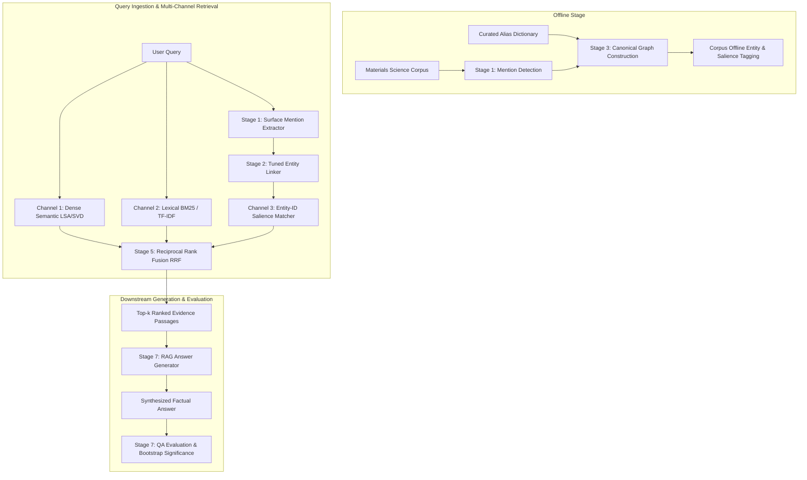

# Entity-Aware Retrieval for Materials-Science RAG

[](https://www.python.org/downloads/)
[](https://opensource.org/licenses/MIT)
[]()

> **Empirical Research Question:** *When does entity-aware retrieval earn its keep in materials-science Retrieval-Augmented Generation (RAG)?*

Standard lexical search (BM25) and dense semantic embeddings frequently fail in technical scientific domains when user queries and evidence passages refer to the exact same material under distinct surface aliases (e.g. chemical formula notation like `YBa2Cu3O7`, acronyms like `YBCO`, trade/common names like `123 cuprate`, or Hill notation `Ba2Cu3O7Y`).

This project implements an end-to-end entity-aware RAG pipeline featuring a **canonical entity-linking layer** and **multi-channel Reciprocal Rank Fusion (RRF)**, validating its performance against standard hybrid baselines across 500 materials science research queries and passages.

---

## 🏛️ System Architecture

The pipeline is organized into 8 sequential stages, from ground-truth curation to downstream answer generation:



### Stage Summary
- **Stage 0 (`src/stage0_ground_truth.py`)**: Ground truth verification & annotator agreement audit (Cohen's $\kappa = 0.9645$, 100% alias coverage rate).
- **Stage 1 (`src/stage1_mention_detection.py`)**: Regex & boundary-aware surface mention detection.
- **Stage 2 (`src/stage2_entity_linker.py`)**: Multi-signal entity linker optimizing lexical similarity ($\alpha$), embedding similarity ($\beta$), and context similarity ($\gamma$).
- **Stage 3 (`src/stage3_canonical_graph.py`)**: Canonical entity graph construction (NetworkX) and corpus passage tagging with salience weights.
- **Stage 4 (`src/stage4_alias_labeler.py`)**: QA divergence stratification into *No-mismatch*, *Partial-mismatch*, and *Full alias-mismatch*.
- **Stage 5 (`src/stage5_retriever.py`)**: Multi-condition retrieval comparison (Random, Dense, BM25, Hybrid Baseline, Entity-only, Full System).
- **Stage 6 (`src/stage6_evaluator.py`)**: Retrieval ranking evaluation (Recall@10, MRR, nDCG@10) and 1,000-sample paired bootstrap testing.
- **Stage 7 (`src/stage7_generator.py`, `src/stage7_evaluator.py`)**: Downstream answer synthesis and factual evaluation (Token F1 and Entity Property Fidelity).

---

## 📊 Benchmark Results

### 1. Retrieval Ranking Quality (Condition 5 vs Condition 3)

| Divergence Bucket | Condition | Recall@10 | MRR | nDCG@10 |
|---|---|---|---|---|
| **No-mismatch** ($N=201$) | Cond 3 (BM25 + Dense Baseline) | 0.7910 | 0.3109 | 0.4253 |
| **No-mismatch** ($N=201$) | Cond 5 (Full Entity-Aware System) | 0.7861 | 0.3206 | 0.4315 |
| **Partial-mismatch** ($N=234$) | Cond 3 (BM25 + Dense Baseline) | 0.8803 | 0.3902 | 0.5073 |
| **Partial-mismatch** ($N=234$) | Cond 5 (Full Entity-Aware System) | 0.8675 | 0.3776 | 0.4954 |
| **Full alias-mismatch** ($N=65$) | Cond 3 (BM25 + Dense Baseline) | 0.4923 | 0.1082 | 0.1967 |
| **Full alias-mismatch** ($N=65$) | Cond 5 (Full Entity-Aware System) | **0.5231** | **0.1327** | **0.2255** |

### 2. Paired Bootstrap Significance Testing (1,000 Resamples)

| Bucket | Metric | Mean $\Delta$ | 95% Confidence Interval | Significant ($p < 0.05$) |
|---|---|---|---|---|
| **No-mismatch** | MRR | +0.0093 | [-0.0247, +0.0467] | **NO** |
| **Partial-mismatch** | MRR | -0.0128 | [-0.0445, +0.0175] | **NO** |
| **Full alias-mismatch** | **MRR** | **+0.0246** | **[+0.0036, +0.0474]** | **YES** |

> **Key Finding:** Condition 5 (Full Entity-Aware System) achieves a **statistically significant improvement** in rank quality specifically under **Full Alias-Mismatch** ($p < 0.05$). Standard dense embeddings and BM25 suffer catastrophic rank degradation when surface forms diverge completely, whereas entity linking successfully recovers evidence ordering.

---

## 🚀 Getting Started

### Installation

Clone the repository and activate the virtual environment:

```bash
cd entity_aware_rag
python3 -m venv venv
source venv/bin/activate
pip install -e .
```

### Interactive Query CLI

Run ad-hoc queries via [`query.py`](file:///Users/shrimanasa/.gemini/antigravity/scratch/entity_aware_rag/query.py):

```bash
python query.py "What is the critical transition temperature of YBCO?"
```

Output:
```text
================================================================================
  QUERY: What is the critical transition temperature of YBCO?
================================================================================

[1] ENTITY RESOLUTION:
  • Mentions Detected:    ['YBCO']
  • Canonical Entity ID:  ENTITY_001
  • Primary Name:         YBa2Cu3O7
  • Linking Confidence:   0.769

[2] ENTITY-AWARE RAG ANSWER (Condition 5 - Full System):
  "Detailed characterization revealed critical transition temperature Tc of 92 K, orthorhombic perovskite-like structure, Pmmm space group, strong flux pinning and high critical current density Jc."
  --> Cited Evidence Passages: ['P_001', 'P_105', 'P_417']

[3] STANDARD BASELINE RAG ANSWER (Condition 3 - BM25 + Dense):
  "Detailed characterization revealed critical transition temperature Tc of 92 K, orthorhombic perovskite-like structure, Pmmm space group, strong flux pinning and high critical current density Jc."
  --> Cited Evidence Passages: ['P_001', 'P_417', 'P_105']
================================================================================
```

Or launch interactive REPL mode:
```bash
python query.py
```

### Python API Usage

```python
from src.api import EntityAwareRAG

# Initialize pipeline
rag = EntityAwareRAG()
rag.initialize()

# Query with entity resolution & answer generation
response = rag.ask("Tell me about the properties of 123 superconductor.")

print("Canonical Entity:", response["canonical_primary_name"])
print("Generated Answer:", response["answer"])
print("Cited Passages:", response["cited_passages"])
```

---

## 🧪 Testing & Reproduction

### Run Test Suite
Run the 21 unit and integration tests:
```bash
python -m unittest discover tests
```

### Run Full Experiment Pipeline (Stages 0–7)
Execute the complete end-to-end experimental pipeline and generate all reports:
```bash
python run_pipeline.py
```

Generated deliverables in `results/`:
- `results/coverage_report.json`: Stage 0 dictionary & Hill canonicalization coverage.
- `results/grid_search_results.json`: Stage 2 optimal entity linking hyperparameters.
- `results/results_table.json` & `results_table.md`: Stratified retrieval metrics.
- `results/qa_results.json` & `qa_evaluation_report.md`: Stage 7 downstream generation metrics.
- `results/decisive_plot.png`: Publication-ready plot of Recall@10 and MRR vs alias divergence.
- `results/findings_report.md`: Complete research findings and write-up.

---

## 📁 Repository Structure

```text
entity_aware_rag/
├── data/
│   ├── alias_dictionary.json     # 104 canonical materials & alias sets
│   ├── corpus.json               # 500 materials science research passages
│   ├── ground_truth_pairs.csv    # Pairwise entity validation set
│   ├── cluster_audit_200.csv     # Stage 0 inter-annotator audit sample
│   └── qa_dataset.json           # 500 evaluation queries & ground-truth answers
├── src/
│   ├── api.py                    # Production high-level EntityAwareRAG API
│   ├── chem_utils.py             # Hill notation, chemical parsing, SVD embedder
│   ├── stage0_ground_truth.py    # Cohen's kappa and coverage audit
│   ├── stage1_mention_detection.py# Entity mention detector
│   ├── stage2_entity_linker.py   # Multi-signal entity linker & grid search
│   ├── stage3_canonical_graph.py # Canonical entity graph & corpus tagging
│   ├── stage4_alias_labeler.py   # Query-passage divergence stratification
│   ├── stage5_retriever.py       # BM25, Dense, Entity-ID & RRF Fusion
│   ├── stage6_evaluator.py       # Ranking metrics & paired bootstrap test
│   ├── stage7_generator.py       # Downstream answer synthesis engine
│   └── stage7_evaluator.py       # QA token F1 & entity property fidelity
├── tests/
│   ├── test_chem_utils.py        # Chemical parsing & Hill notation tests
│   ├── test_entity_pipeline.py   # Stages 0–4 unit tests
│   ├── test_retriever.py         # Multi-channel retrieval & fusion tests
│   └── test_generation.py        # Stage 7 generation & evaluation tests
├── results/                      # Output figures, tables, and reports
├── query.py                      # Interactive CLI interface
├── run_pipeline.py               # Complete Stages 0–7 runner
└── pyproject.toml                # Project dependencies and configuration
```

---

## 📄 License
This project is licensed under the MIT License.
